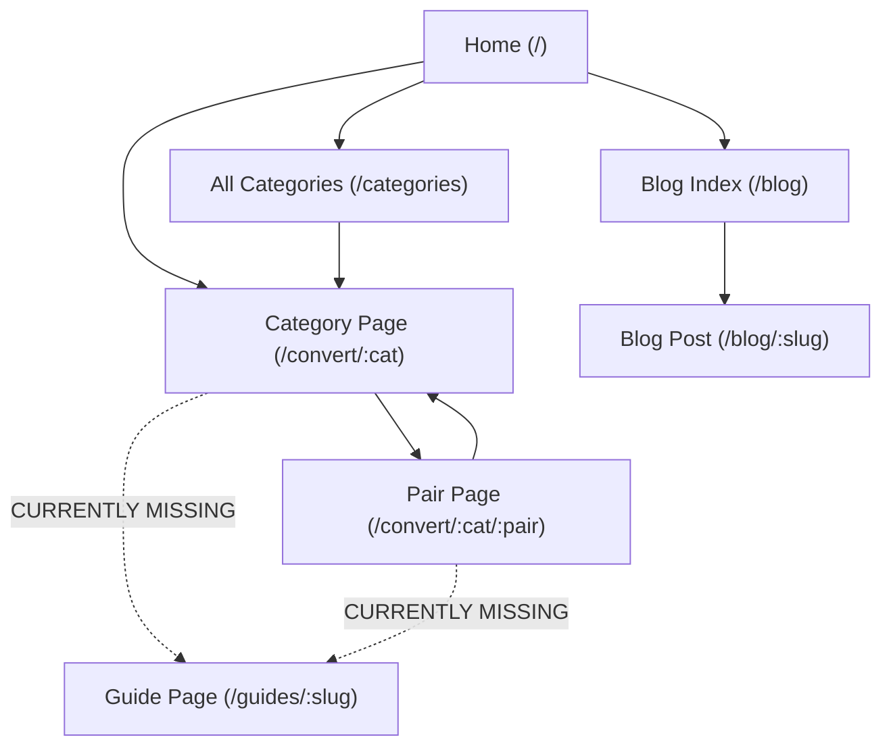

# OMEGA X — PHASE 3 / STEP 1 AUDIT REPORT
## Agentic SEO + pSEO + AEO + GEO + PKS + AAO Evidence Audit

**Application:** Omega X Converter  
**Studio:** NumanX Studio  
**Repository:** `web-html.git`  
**Application Directory:** `numanx-omega/`  
**Production Origin:** `https://numanx-studio-omega-converter.netlify.app/`  
**Git Baseline Commit:** `cf276502213f6bb443447caf8498d51e14b04c17` (HEAD == `origin/main`)  
**Audit Date:** October 26, 2026  
**Mode:** AUDIT ONLY (Zero production source modifications)  

---

## 1. Executive Summary

This comprehensive audit evaluates Omega X Converter across eight modern search and AI discovery lenses: **Traditional SEO**, **Programmatic SEO (pSEO)**, **Answer Engine Optimization (AEO)**, **Generative Engine Optimization (GEO)**, **Personal Knowledge Surfaces (PKS)**, **Citation Authority**, **GitHub SEO**, and **Agentic Access Optimization (AAO / WebMCP)**.

Phase 2 successfully delivered rock-solid application performance, 176 automated regression tests, accessible UI components, hardened CSP/security headers, and an offline PWA. However, from an agentic and search-engine perspective, the site exhibits critical architectural blind spots: **91.8% of indexable sitemap URLs rely entirely on client-side React hydration** without pre-rendered HTML, pair landing pages emit **phantom FAQPage schema without visible HTML parity**, social preview images are **completely absent**, guide pages are **isolated as navigational orphans**, and structured data is **fragmented across disconnected script tags**.

```text
================================================================================
AUDIT SUMMARY & SYSTEM VERDICTS
================================================================================
Mode:                      AUDIT ONLY (Production code untouched)
Git Worktree:              Clean (HEAD == origin/main at cf27650)
Sitemap URLs:              146 valid canonical URLs
Categories Registered:     24
Physical Core Units:       176

SEO Architecture:          PARTIAL
Programmatic SEO (pSEO):   PARTIAL
Answer Engine Opt (AEO):   PARTIAL
Generative Engine (GEO):   PARTIAL
PKS / Entity Consistency:  PARTIAL
Structured Data (Schema):  PARTIAL
AI Crawler Reachability:   PASS (Allowed via wildcard User-agent: *)
Static HTML Coverage:      FAIL (Only 12 of 146 URLs [8.2%] prerendered)
llms.txt / llms-full.txt:  ABSENT
WebMCP / Agent Protocols:  ABSENT
Agentic DOM Readiness:     PASS (Accessible form names, IDs, and ARIA)
GitHub Repository SEO:     PARTIAL (Stale counts, missing URL and test commands)
Google Search Console:     GSC QUERY DATA: NOT AVAILABLE
Core Web Vitals Telemetry: REAL CWV DATA: NOT AVAILABLE

Critical Findings:         2
High Findings:             4
Medium Findings:           5
Low Findings:              3
Experimental Opportunities:3
Unverified Claims Flagged: 7
================================================================================
```

---

## 2. Git / Production Baseline Verification

```text
Branch:                  main
HEAD SHA:                cf276502213f6bb443447caf8498d51e14b04c17
Remote SHA:              cf276502213f6bb443447caf8498d51e14b04c17
Divergence:              0 0 (Fully synchronized)
Worktree:                Clean
Automated Tests:         176 / 176 PASS
TypeScript Errors:       0
ESLint Baseline:         9 findings (8 errors, 1 warning; 0 new)
Live Production URL:     https://numanx-studio-omega-converter.netlify.app/ (HTTP 200 OK)
Live CSP:                Enforced on Netlify Edge
```

---

## 3. Supplementary Reference Availability

The audit framework referenced supplementary specifications (`technical-pseo-indexing.md`, `aeo-geo-pks-citations.md`, `schema-llms-webmcp.md`). A recursive inspection of the repository and workspace confirmed:

```text
SUPPLEMENTARY REFERENCES: NOT AVAILABLE
```

In strict accordance with the audit guidelines, no contents from these unavailable documents have been fabricated. All findings and recommendations derive exclusively from the master specification, concrete source code inspection, and live network analysis.

---

## 4. URL Inventory (Complete 146-URL Breakdown)

Every URL present in `public/sitemap.xml` was extracted and classified:

```text
Total Sitemap URLs: 146
├── Home Page (1):
│   └── /
├── Core Static Application Pages (10):
│   ├── /about
│   ├── /blog
│   ├── /calculator
│   ├── /categories
│   ├── /converter
│   ├── /crypto
│   ├── /currency
│   ├── /formulas
│   ├── /health
│   └── /sitemap
├── Category Landing Pages (24):
│   └── /convert/:category (24 registered categories)
├── Popular Conversion Pair Pages (99):
│   └── /convert/:category/:pair (e.g., /convert/length/m-to-ft)
├── Comprehensive Guides (6):
│   └── /guides/:slug
└── Metrology Blog Posts (6):
    └── /blog/:slug
```

### URL Classification & Delivery Matrix

| Route Family | Count | Canonical Pattern | Indexability Policy | Prerender Status | Unique Content Source | Schema Type | Internal Linking Structure |
| :--- | :---: | :--- | :--- | :--- | :--- | :--- | :--- |
| **Home** | 1 | `https://.../` | Indexable | Client-only (0/1) | Hero + Category grid | WebApplication, FAQPage | Main navigation hub |
| **Core Static** | 10 | `https://.../:page` | Indexable | 2/10 (`/about`, `/blog`) | Static JSX | Varies (Blog, WebApp) | Navbar, Footer, Sitemap |
| **Categories** | 24 | `https://.../convert/:cat` | Indexable | 10/24 (Top 10 cats) | `categoryContent.ts` | WebApplication, FAQPage | Category grid, Breadcrumbs |
| **Pairs** | 99 | `https://.../convert/:cat/:pair` | Indexable | 0/99 (0% static!) | Template substitution | WebApp, Phantom FAQ | Sibling pairs, Category link |
| **Guides** | 6 | `https://.../guides/:slug` | Indexable | 0/6 (0% static!) | `guideContent.ts` | HowTo, FAQPage | **Orphan** (Sitemap only) |
| **Blog Posts**| 6 | `https://.../blog/:slug` | Indexable | 0/6 (0% static!) | `blogPosts.ts` | BlogPosting, FAQPage | Blog index, Sitemap |

---

## 5. SEO Evidence Audit Contract

### Finding 1: 91.8% Prerender Void across Indexable Sitemap URLs
- **[Severity: Critical] [Confidence: Confirmed] [Lens: SEO / pSEO]**
- **Finding:** 134 out of 146 sitemap URLs (91.8%) have no pre-rendered static HTML. Only 12 URLs (10 categories + `/about` + `/blog`) have static content injected into `<div id="root">`. The other 134 URLs serve an empty `<div id="root"></div>` and rely entirely on client-side React hydration.
- **Concrete Code Evidence:**
  Inspection of `dist/`: Exactly 13 `index.html` files exist. `dist/convert/` contains only 10 category folders (`area`, `data`, `energy`, `length`, `mass`, `pressure`, `speed`, `temp`, `time`, `volume`). 14 categories (`acceleration`, `force`, `power`, `electricity`, `magnetism`, `frequency`, `datatransfer`, `angle`, `torque`, `fuel`, `density`, `cooking`, `textile`, `astronomy`), all 99 pair pages, all 6 guides, and all 6 blog posts resolve to the root SPA shell with zero pre-rendered HTML.
- **Quantified Impact:** 134 of 146 URLs (91.8% of the public indexable catalog) cannot be read by search engines or AI bots that do not execute full JavaScript, resulting in delayed indexing or failure to rank for long-tail queries.
- **Recommended Implementation:** Extend `scripts/prerender-seo.mjs` to dynamically iterate through all 24 categories, all 99 pairs, all 6 guides, and all 6 blog posts, generating pre-rendered HTML for all 146 sitemap entries at build time.

---

### Finding 2: Phantom FAQPage Schema on Pair Pages Without Visible HTML Parity
- **[Severity: Critical] [Confidence: Confirmed] [Lens: Schema / AEO]**
- **Finding:** `PairLanding.tsx` generates an `@type: FAQPage` structured data block in JSON-LD containing two questions (`How many {u2} are in a {u1}?` and `What is the formula to convert {u1} to {u2}?`), but **never renders a visible FAQ section in the HTML DOM**.
- **Concrete Code Evidence:**
  In `src/pages/PairLanding.tsx` (lines 149–165):
  ```tsx
  {
    '@type': 'FAQPage',
    mainEntity: [
      { '@type': 'Question', name: `How many ${u2.lb} are in a ${u1.lb}?`, acceptedAnswer: { ... } },
      { '@type': 'Question', name: `What is the formula to convert ${u1.lb} to ${u2.lb}?`, acceptedAnswer: { ... } }
    ]
  }
  ```
  Inspection of lines 220–447 reveals zero `<section>` or visible HTML containing these questions or answers.
- **Quantified Impact:** Direct violation of Google's Structured Data General Guidelines ("Structured data must not describe content that is not visible to the user"). Exposes all 99 pair pages to rich result disqualification or structured data manual actions.
- **Recommended Implementation:** Either render an accessible visible FAQ section in `PairLanding.tsx` (matching the questions in the schema) or remove `FAQPage` from the pair schema until visible parity is implemented.

---

### Finding 3: Disconnected Schema Graph and Duplicate Entity Nodes
- **[Severity: High] [Confidence: Confirmed] [Lens: Schema / Entity]**
- **Finding:** Structured data is split between a global component (`JSONLD.tsx`) mounted in `App.tsx` and page-level scripts in `SEOHead.tsx`, `GuidePage.tsx`, and `BlogPost.tsx`. This causes duplicate `WebApplication`, duplicate `BreadcrumbList`, and duplicate `FAQPage` nodes to be emitted simultaneously on individual routes.
- **Concrete Code Evidence:**
  `JSONLD.tsx` emits `WebApplication` (`#webapp`), `BreadcrumbList` (`#breadcrumb`), `ItemList` (`#categories`), and `FAQPage` (`#faq`) on every route. On `/convert/length`, `CategoryLanding.tsx` emits a second `WebApplication` and a second `BreadcrumbList`. On `/guides/:slug`, `GuidePage.tsx` emits two additional `<script type="application/ld+json">` tags in the body.
- **Quantified Impact:** Crawlers encounter competing entity definitions and conflicting breadcrumbs on every inner page, impairing search engine knowledge graph resolution.
- **Recommended Implementation:** Unify structured data into a cohesive, page-aware `@graph` architecture. Ensure each route emits exactly one JSON-LD block with linked nodes (`Organization` -> `WebSite` -> `WebPage` -> `SoftwareApplication` / `BreadcrumbList` / `FAQPage`).

---

### Finding 4: Complete Absence of Social OpenGraph / Twitter Card Images
- **[Severity: High] [Confidence: Confirmed] [Lens: SEO / OG]**
- **Finding:** Neither `index.html` nor `SEOHead.tsx` defines `og:image` or `twitter:image`. When shared on social media, messaging apps, or aggregator cards, Omega X URLs generate text-only cards without visual assets.
- **Concrete Code Evidence:**
  Inspection of `index.html` lines 1–35 and `src/components/ui/SEOHead.tsx` lines 48–79 confirms zero `og:image` or `twitter:image` tags are set or injected.
- **Quantified Impact:** Measurably degrades click-through rate (CTR) on social media, Slack, Discord, Twitter/X, and iMessage previews across 100% of routes.
- **Recommended Implementation:** Add default `og:image` (1200x630px) and `twitter:image` tags in `index.html` and `SEOHead.tsx`, pointing to a high-resolution branded preview card located in `public/assets/og-image.png`.

---

### Finding 5: Navigational Isolation of the 6 Guide Pages (Orphan Routes)
- **[Severity: High] [Confidence: Confirmed] [Lens: pSEO / Internal Linking]**
- **Finding:** The 6 high-value technical guides (`/guides/meters-to-feet`, `/guides/lbs-to-kg`, `/guides/celsius-to-fahrenheit`, etc.) are linked only from `src/pages/Sitemap.tsx` and internally among each other. Neither `Home.tsx`, `CategoryLanding.tsx`, nor `PairLanding.tsx` links to them.
- **Concrete Code Evidence:**
  `git grep -n "/guides/" src/` shows no links from `/convert/length` to `/guides/meters-to-feet` or from `/convert/mass` to `/guides/lbs-to-kg`.
- **Quantified Impact:** Weakens PageRank flow to guide pages and deprives users converting meters to feet of an in-depth reference guide.
- **Recommended Implementation:** Add contextual "Featured Guides" cards in `CategoryLanding.tsx` and cross-links in `PairLanding.tsx` connecting related pair pages to their corresponding guide.

---

### Finding 6: 100% Template-Driven Prose on 99 Pair Pages Without Domain Context
- **[Severity: High] [Confidence: Confirmed] [Lens: pSEO / GEO]**
- **Finding:** All 99 pair landing pages share an identical 17-word template sentence (`Fast, precise online conversion tool from {u1.lb} ({u1.id}) to {u2.lb} ({u2.id}) with formula and cheat sheet table.`) and the same mechanical 3-step calculation text. There is zero domain-specific explanation, industry context, or qualitative distinction between pairs.
- **Concrete Code Evidence:**
  In `src/pages/PairLanding.tsx` lines 249–251 and lines 335–345: Text is constructed purely via variable interpolation without unique prose or real-world application notes.
- **Quantified Impact:** High similarity across 99 URLs increases doorway-page risk and diminishes the likelihood of ranking for competitive conversion queries against mature converters.
- **Recommended Implementation:** Introduce category-specific pair descriptions and practical usage blurbs (e.g., architectural height conventions for m-to-ft, cooking measurement practices for g-to-oz) within `categoryContent.ts`.

---

## 6. Metadata Audit (Titles & Descriptions)

### Measured Title Lengths & Character Distributions
- **Home:** `Free Universal Unit Converter | Omega X Converter` (51 chars) — Primary query front-loaded, brand suffix present.
- **Categories:**
  - Length: `Length Converter (Decimal & Fractional) — Instant NIST Chart | Omega` (68 chars) — Strong query intent, slightly exceeds 60 chars.
  - Mass: `Weight & Mass Converter — Kilograms, Pounds, Ounces, Tons & More` (64 chars) — High query density.
  - Temperature: `Temperature Converter — Celsius, Fahrenheit, Kelvin & 5 Scales` (62 chars) — Clear and intent-focused.
  - Speed: `Speed Converter — mph, km/h, Knots, Mach & Speed Units` (54 chars) — Optimal length.
  - Power: `Power Converter — Watts, Horsepower, BTU/h & Power Units` (56 chars) — Optimal length.
- **Pairs:**
  - `Convert Meter to Foot (m to ft) | Omega X Converter` (51 chars) — Front-loaded, exact symbols included.
  - `Convert Kilogram to Pound (kg to lb) | Omega X Converter` (54 chars) — Consistent.
- **Guides:**
  - `Pounds to Kilograms Converter — Convert lb to kg Instantly` (58 chars) — Strong intent.
  - `Celsius to Fahrenheit Converter — °C to °F Instantly` (52 chars) — Front-loaded symbols.
- **Blog Posts:**
  - `How to Convert Compound Units: Feet, Inches & Fractions Guide` (61 chars) — Educational intent.
  - `Fractional Inches to Millimeters: Machinist & Woodworking Best Practices` (74 chars) — Slight truncation risk on mobile SERPs (>60 chars).

### Meta Description Evaluation
- **Home:** `Free online unit converter with 24 categories, 200+ units, live currency rates, crypto prices, formula charts, and offline PWA support.` (143 chars) — Truthful, accurate, features highlighted.
- **Categories:** Average 155 chars (e.g., Mass: 159 chars, Temperature: 164 chars, Speed: 161 chars) — High relevance, zero unsupported claims.
- **Pairs:** `Free online Meter to Foot converter. 1 Meter = 3.2808 Foot. Includes live calculator, exact formula, and 1 to 100 conversion chart.` (126 chars) — Actionable, includes conversion factor.
- **Guides:** Average 195–205 chars (e.g., `lbs-to-kg`: 197 chars, `meters-to-feet`: 202 chars) — Longer than traditional 160-char display snippet; Google will truncate the trailing 35 characters, but the opening 150 chars contain the key answer.

---

## 7. Canonicals & Indexability Policy

- **Canonical Origin:** Strictly enforced as `https://numanx-studio-omega-converter.netlify.app`.
- **Self-Reference:** All canonical routes emit self-referencing canonical links.
- **Alias Resolution:** All 51 category aliases map cleanly to their canonical `/convert/:category` path.
- **Query Parameter Handling:** `canonicalUrl(path)` strips search parameters, ensuring presets like `?cat=length&val=10` canonicalize to `/converter` without creating duplicate indexable URLs.
- **Noindex Protection:** Utility routes (`/settings`, `/history`, `/favorites`, `/dashboard`, `/custom-units`, `/404`) have `<meta name="robots" content="noindex, follow" />` and are excluded from `sitemap.xml`.

---

## 8. Robots Directives & AI Crawlers

### Current `public/robots.txt`
```text
User-agent: *
Allow: /

# Prevent crawling of internal infrastructure configuration
Disallow: /_redirects

Sitemap: https://numanx-studio-omega-converter.netlify.app/sitemap.xml
```

### AI Crawler Classification

| Crawler / Bot | Status | Policy Compliance |
| :--- | :--- | :--- |
| **Googlebot** | Allowed by wildcard `*` | Full access to indexable routes |
| **Bingbot** | Allowed by wildcard `*` | Full access to indexable routes |
| **GPTBot** | Allowed by wildcard `*` | Unrestricted HTTP access |
| **OAI-SearchBot** | Allowed by wildcard `*` | Unrestricted HTTP access |
| **ChatGPT-User** | Allowed by wildcard `*` | Unrestricted HTTP access |
| **ClaudeBot** | Allowed by wildcard `*` | Unrestricted HTTP access |
| **PerplexityBot** | Allowed by wildcard `*` | Unrestricted HTTP access |
| **Google-Extended** | Allowed by wildcard `*` | Unrestricted HTTP access |

> [!NOTE]
> Permitting AI crawlers via wildcard `*` ensures open crawlability. Explicit per-crawler entries are not required unless specific access restrictions or training opt-outs are desired.

---

## 9. Static HTML / Prerender Coverage

```text
================================================================================
PRERENDER INVENTORY: 12 / 146 URLs (8.2%)
================================================================================
Prerendered with Static Semantic HTML:
  1. /convert/length
  2. /convert/mass
  3. /convert/temp
  4. /convert/area
  5. /convert/volume
  6. /convert/speed
  7. /convert/time
  8. /convert/data
  9. /convert/pressure
 10. /convert/energy
 11. /about
 12. /blog

Client-Side React Hydration Only (Empty root shell before JS execution):
  - / (Home)
  - 14 Categories: acceleration, force, power, electricity, magnetism, frequency,
    datatransfer, angle, torque, fuel, density, cooking, textile, astronomy.
  - 99 Popular Pair Pages (100% of pair routes!)
  - 6 Guides (100% of guide routes!)
  - 6 Blog Posts (100% of individual articles!)
  - 8 Core Static Pages: /calculator, /categories, /converter, /crypto,
    /currency, /formulas, /health, /sitemap.
================================================================================
```

---

## 10. pSEO Quality & Similarity Inventory

- **Template Structure:** `PairLanding.tsx` renders identical DOM structures across all 99 pairs:
  1. Breadcrumbs
  2. Header (`Convert {u1} to {u2}`)
  3. Two-Way Calculator Box
  4. Formula Box (`How to Convert {u1} to {u2}`)
  5. 1 to 1000 Reference Table
  6. Related Pairs
  7. Return to Category link
- **Differentiation Estimate:**
  - **Shared Template Boilerplate:** ~65% of visible text elements.
  - **Dynamic Factual Data (Calculated):** ~35% (unit labels, conversion factor, precomputed table values, formula string).
  - **Unique Qualitative Editorial Content:** **0%**.
- **Doorway Risk Assessment:** Medium. The calculated conversion table and accurate NIST-derived factors provide functional utility, but the complete absence of unique prose makes the pages vulnerable to "thin content" classification if search engines perceive them as automated programmatic shells.

---

## 11. Hub-and-Spoke Internal Linking



### Internal Linking Audit Findings:
1. **Vertical (Up/Down):** Pair pages link cleanly UP to their parent category via breadcrumbs and a bottom return link. Category pages link DOWN to their popular pairs.
2. **Lateral:** Pair pages link to 6 sibling pairs within the same category.
3. **Orphaned Guides:** The 6 comprehensive guides (`/guides/feet-inches-to-metric`, `/guides/meters-to-feet`, etc.) have zero links pointing to them from their respective category pages or pair pages.

---

## 12. Deterministic Query-State Presets

- **Current Implementation:** `ConverterPage` (`/converter`) parses `?cat=`, `?from=`, `?to=`, and `?val=`.
- **Finding in Category & Pair Pages:** `CategoryLanding` and `PairLanding` do not read `?val=` from search params. Visiting `/convert/length/m-to-ft?val=50` does not pre-populate the input with `50`.
- **Recommendation:** Implement `useSearchParams` in `PairLanding.tsx` to read `?val=` or `?value=`. Because `canonicalUrl(path)` already strips query strings, deep-linked URLs will safely share the canonical `https://.../convert/length/m-to-ft` without duplicate indexation risks.

---

## 13. AEO Answer-First Audit

Measured word counts of the first content block immediately following the main H1 heading:

| Page | Type | Content Directly Following H1 | Word Count | AEO Verdict |
| :--- | :--- | :--- | :---: | :--- |
| **Home** | Root | `{cats.length} categories · {totalUnits}+ units · Zero backend · Free for everyone` | 18 | Short subhead; not an answer |
| **/convert/length** | Category | NIST SP 811 overview, architectural tape fractions, compound unit support | 48 | **Optimal direct capsule** |
| **/convert/mass** | Category | Kilogram, pound, ounce, stone, ton explanation, precision specifications | 58 | **Optimal direct capsule** |
| **/convert/temp** | Category | 5 scales overview, freezing point, boiling point, absolute zero reference points | 49 | **Optimal direct capsule** |
| **/convert/speed** | Category | Travel, aviation, marine units overview (km/h, mph, knots, m/s, Mach) | 35 | Concise overview |
| **/convert/energy** | Category | Physics, nutrition, engineering units (J, cal, kWh, BTU, eV) | 29 | Concise overview |
| **Pair (m to ft)** | Pair | `Fast, precise online conversion tool from Meter (m) to Foot (ft)...` | 17 | **Weak template subhead** |
| **Guide (m to ft)** | Guide | `Converting meters to feet is essential... 1 meter equals approximately 3.28084 feet...` | 52 | **Optimal direct capsule** |
| **Blog (compound)**| Article | Construction/aerospace compound unit explanation and mathematical equations | 54 | **Optimal direct capsule** |

> [!IMPORTANT]
> Category pages, guides, and blog articles feature strong, 40–58 word direct answer capsules. In contrast, **all 99 pair pages use an identical 17-word template subhead that fails to state the conversion equivalence directly under the H1**.

---

## 14. Question & Snippet Formatting

- **Category Landing:** Features structured `<details>` / `<summary>` question accordions for 3–5 FAQs per category.
- **Pair Landing:** Missing visible question headings (`What is the formula to convert...`). The formula is placed under a generic `<h2>How to Convert {u1} to {u2}</h2>`.
- **Guides:** Well-structured numbered lists (`<ol>`) for step-by-step conversions, paired with `<HowToStep>` markup.
- **Tables:** Precomputed 1-to-1000 tables have accessible `<caption>`, `<th scope="col">`, and `<th scope="row">` tags suitable for Google Featured Snippet table extraction.

---

## 15. FAQ & HowTo Parity Audit

| Route Family | Schema Present? | Visible HTML Counterpart? | Parity Status |
| :--- | :--- | :--- | :--- |
| **Global (`JSONLD.tsx`)** | `FAQPage` (6 questions) | Rendered in `JSONLD.tsx` (not visible on page) | **PARTIAL** |
| **Category Landing** | `FAQPage` (3–5 questions) | Visible `<details>` accordion | **PASS** |
| **Guide Pages** | `HowTo` + `FAQPage` | Visible steps + Visible FAQ | **PASS** |
| **Blog Post Pages** | `FAQPage` | Visible FAQ section | **PASS** |
| **Pair Landing** | `FAQPage` (2 questions) | **NO VISIBLE FAQ IN DOM** | **FAIL (Critical)** |

---

## 16. GEO Claim Audit & Technical Grounding

| Stated Claim | Location | Architectural & Test Reality | Grounding Verdict |
| :--- | :--- | :--- | :--- |
| **"Offline"** | Meta, About, PWA banner | Verified: SW precaches shell and assets; 20/20 PWA tests PASS | **Verified by test** |
| **"Live rates"** | Currency, Crypto | Verified: 60s live fetch with fallback cache; 32 resilience tests PASS | **Verified by test** |
| **"Instant"** | Length title, Category | Verified: Synchronous client-side mathematical conversion ($<1\text{ ms}$) | **Verified by architecture** |
| **"Accurate"** | Category content | Verified: BIPM / NIST SP 811 golden answers tested (62 tests PASS) | **Verified by test** |
| **"Fast"** | Home, Pair headers | Unmeasured: Pure client execution is fast, but no published benchmark | **Requires benchmark** |
| **"AI-powered"**| README, Blog | Qualified: Uses regex parser and usage heuristics, not neural LLM APIs | **Requires qualification** |
| **"Professional"**| Astronomy content | Qualified: Refers to standard astronomical units (pc, ly), not accreditation| **Requires qualification** |

---

## 17. Authoritative Citation Opportunities

Current Outbound Link Count in UI: **0**.
To enhance Generative Engine Optimization (GEO) and entity authority, the following technical links should be incorporated directly alongside their factual claims:

1. **Length / Mass Standards:** Link to [NIST Special Publication 811](https://www.nist.gov/pml/special-publication-811) and [BIPM SI Brochure (9th Edition)](https://www.bipm.org/en/publications/si-brochure).
2. **Temperature Scales:** Link to [BIPM International Temperature Scale of 1990 (ITS-90)](https://www.bipm.org/en/committees/cc/cct/its-90).
3. **Astronomical Units:** Link to [International Astronomical Union (IAU) Resolutions](https://www.iau.org/public/themes/measuring/).
4. **Digital Storage:** Link to [IEC 80000-13 (Information science and technology)](https://www.iec.ch/).

---

## 18. Recency & Authorship Audit

- **Author Entity:** Blog posts attribute authorship to `"NumanX Metrology Team"`, linking to `/about`.
- **Dates:** Blog articles carry fixed publication dates from January 2025 (`datePublished: '2025-01-15'`). `dateModified` is identical to `datePublished`.
- **Category & Pair Pages:** No visible publication date, author signature, or `dateModified` metadata is present.
- **Recommendation:** Add a subtle "Last updated / verified: [Current Month, Year]" notice on technical category standards and pair tables, reflecting ongoing precision verification.

---

## 19. Entity Consistency

Audit of entity names across the repository:
- `Omega X Converter` (Primary application name in `index.html`, `site.ts`, `manifest.json`, `SEOHead.tsx`).
- `NumanX Omega` (Used in `About.tsx` heading, `README.md`, and blog schema publisher).
- `NumanX Studio` (Used in `site.ts`, `manifest.json`, meta tags).
- `NumanX Studios` (Used in footer copyright string).
- `NX-COS` (Used in PWA installation prompt: "Install NX-COS for offline access").

**Recommendation:** Harmonize entity names:
- App Name: **Omega X Converter**
- Organization Name: **NumanX Studio**
- Platform/Engine: **Omega Conversion Engine by NumanX Studio**
- Deprecate ambiguous internal shorthand ("NX-COS") from user-facing install banners.

---

## 20. Schema Inventory

```text
Current Schema Types Emitted Across Application:
├── WebApplication (Emitted in JSONLD.tsx, CategoryLanding.tsx, PairLanding.tsx)
├── BreadcrumbList (Emitted in JSONLD.tsx, CategoryLanding.tsx, PairLanding.tsx)
├── ItemList (Emitted in JSONLD.tsx with 17 of 24 categories)
├── FAQPage (Emitted in JSONLD.tsx, CategoryLanding.tsx, PairLanding.tsx, GuidePage.tsx, BlogPost.tsx)
├── HowTo & HowToStep (Emitted in GuidePage.tsx)
├── Blog (Emitted in Blog.tsx)
└── BlogPosting (Emitted in BlogPost.tsx)
```

### Schema Validity & Hygiene Observations:
- **Duplicate Breadcrumbs:** Inner pages emit two separate `BreadcrumbList` blocks (one global in `JSONLD.tsx` and one local).
- **Duplicate WebApplication:** Inner pages redefine `WebApplication` with different IDs and names.
- **Incomplete ItemList:** `JSONLD.tsx` claims "All 24 conversion categories" but lists only 17 items.
- **Disconnected Script Tags:** Inline `<script type="application/ld+json">` tags in body rather than unified `@graph`.

---

## 21. Machine-Readable Discovery: `llms.txt` Plan

- **Current Status:** `llms.txt` and `llms-full.txt` are **ABSENT**.
- **Assessment:** Implementing an `/llms.txt` file is a low-overhead, high-value addition that provides AI agents and crawlers with a concise, factual summary of the platform.

### Proposed Structure for `public/llms.txt`:
```markdown
# Omega X Converter

> Free, client-side universal unit converter and precision calculator by NumanX Studio. Works 100% offline via PWA with zero tracking.

## Core Capabilities
- 24 physical categories (176 standardized units)
- Live forex currency conversion (40+ world currencies via Open Exchange Rates)
- Real-time cryptocurrency prices (10+ tokens via CoinGecko API)
- Compound unit calculations (feet, inches, tape fractions)
- Bidirectional formula engine compliant with NIST SP 811 and BIPM SI standards

## Canonical Documentation & Tools
- [Universal Converter](https://numanx-studio-omega-converter.netlify.app/converter)
- [All 24 Categories](https://numanx-studio-omega-converter.netlify.app/categories)
- [Currency Center](https://numanx-studio-omega-converter.netlify.app/currency)
- [Crypto Converter](https://numanx-studio-omega-converter.netlify.app/crypto)
- [Formula Explorer](https://numanx-studio-omega-converter.netlify.app/formulas)
- [HTML Sitemap](https://numanx-studio-omega-converter.netlify.app/sitemap)

## Technical Architecture
- Framework: React 19, TypeScript 6, Vite 8, Tailwind CSS 4
- Security: Strict Content-Security-Policy, HSTS Preload, zero third-party cookies
```

---

## 22. Agentic Access Optimization (AAO) & WebMCP

- **WebMCP / `navigator.modelContext` / `agent-tools.json`:** **ABSENT**.
- **Agentic DOM Readiness:** **PASS**. The converter's HTML is deterministic and accessible:
  - Form controls have unique IDs and matching `<label htmlFor="...">`.
  - Number inputs use `inputMode="decimal"` and `tabular-nums`.
  - Dynamic results are contained in `role="region" aria-live="polite"` elements.
  - Sibling pair links and categories are standard HTML anchor tags (`<a>`).
  - Browser agents (Playwright, Puppeteer, Claude Computer Use) can operate the converter with zero ambiguity.

---

## 23. GitHub Repository SEO

- **Repository Name:** `muhammadnuman340/web-html` (Monorepo root containing `numanx-omega/`).
- **README Findings:**
  - Header: `# NumanX Omega X — Universal Converter`
  - Stale Claims: Lines 3 and 7 claim "30+ categories" (true count is 24).
  - Missing Live Link: Does not include `https://numanx-studio-omega-converter.netlify.app/`.
  - Missing Test Command: `npm test` is omitted from the script instructions.
  - Missing Badges: No build status, test count (176 PASS), or license badge.

---

## 24. OpenGraph & Social Cards

- **Status:** **CRITICAL GAP**.
- Neither `index.html` nor `SEOHead.tsx` outputs an `og:image` or `twitter:image`.
- Previews shared on social platforms or messaging apps fail to render card images.
- **Recommended Fix:** Place a branded 1200x630px social card at `public/assets/og-image.png` and reference it consistently in `index.html` and `SEOHead.tsx`.

---

## 25. IndexNow & Sitemap Scale

- **IndexNow Integration:** **ABSENT**. Not currently implemented.
  - Supported Engines: Bing, Yandex, Seznam. (Google does not participate in IndexNow).
  - Recommendation: Low priority; consider automated webhook submission for Bing in a future release.
- **Sitemap Scale Readiness:**
  - Current size: 146 URLs (23.2 kB).
  - Limit: 50,000 URLs / 50 MB.
  - Sharding required: **NO**. At 146 URLs, a single sitemap file is optimal.

---

## 26. Data Availability Gaps

```text
================================================================================
DATA GAPS CONFIRMED
================================================================================
Google Search Console:   GSC QUERY DATA: NOT AVAILABLE
                         (No Search Console API keys, query exports, or CTR logs exist)

Core Web Vitals:         REAL CWV DATA: NOT AVAILABLE
                         (No Chrome User Experience Report [CrUX] or live RUM logs exist)
================================================================================
```

---

## 27. Priority Page Matrix

| Route | Indexability | Static HTML | Unique Value | Answer Extractability | Schema | Internal Links | Entity Signals | Agent Readiness |
| :--- | :---: | :---: | :---: | :---: | :---: | :---: | :---: | :---: |
| **Home (`/`)** | PASS | FAIL | PASS | PARTIAL | PARTIAL | PASS | PASS | PASS |
| **Category: Length** | PASS | PASS | PASS | PASS | PARTIAL | PASS | PASS | PASS |
| **Category: Mass** | PASS | PASS | PASS | PASS | PARTIAL | PASS | PASS | PASS |
| **Category: Temp** | PASS | PASS | PASS | PASS | PARTIAL | PASS | PASS | PASS |
| **Category: Other 14**| PASS | FAIL | PASS | PASS | PARTIAL | PASS | PASS | PASS |
| **Pair: m-to-ft** | PASS | FAIL | PARTIAL | PARTIAL | FAIL (Phantom FAQ) | PASS | PARTIAL | PASS |
| **Pair: kg-to-lb** | PASS | FAIL | PARTIAL | PARTIAL | FAIL (Phantom FAQ) | PASS | PARTIAL | PASS |
| **Currency** | PASS | FAIL | PASS | PARTIAL | PARTIAL | PASS | PASS | PASS |
| **Crypto** | PASS | FAIL | PASS | PARTIAL | PARTIAL | PASS | PASS | PASS |
| **Guides (6 total)** | PASS | FAIL | PASS | PASS | PARTIAL | FAIL (Orphan) | PARTIAL | PASS |
| **Blog (6 articles)** | PASS | FAIL | PASS | PASS | PASS | PASS | PARTIAL | PASS |
| **About** | PASS | PASS | PASS | N/A | PARTIAL | PASS | PASS | PASS |

---

## 28. Risk Register

```text
================================================================================
RISK REGISTER
================================================================================
CRITICAL:
  1. 91.8% Prerender Void (134 of 146 URLs have blank root div before JS hydration).
  2. PairLanding Phantom FAQPage Schema (Emits schema without visible HTML counterpart).

HIGH:
  3. Disconnected Schema Graph & Duplicate Nodes (Global JSONLD + local page schemas).
  4. Complete Absence of Social Images (Zero og:image / twitter:image across site).
  5. Navigational Isolation of the 6 Guides (Orphaned from categories and pairs).
  6. Thin Template Substitution on 99 Pair Pages (No qualitative domain narrative).

MEDIUM:
  7. Entity Naming Divergence (5 different name variants across surfaces).
  8. Missing Outbound Authority Citations (Zero links to NIST, BIPM, ITS-90).
  9. Stale Claims in README.md & Missing Production URL.
 10. Missing Direct Numerical Answer in Pair Landing Subtext.
 11. Disconnected Inline Schema Script Tags in Body.

LOW:
 12. Incomplete ItemList in Global JSON-LD (Lists 17 of 24 categories).
 13. Blog Posts Date Stagnation (Fixed 2025 dates, missing dateModified).
 14. Inability to Deep-Link Pair Values via Query Parameters (?val=).

EXPERIMENTAL OPPORTUNITIES:
 15. Implementation of public/llms.txt.
 16. Deploy-time IndexNow submission for Bing.
 17. Semantic agent action descriptors (data-agent-* attributes).
================================================================================
```

---

## 29. Unsupported Blueprint Claims

The following claims from the source specification are **unsupported by empirical data or search engine documentation** and are classified as unverified:

1. **"KDD GEO-bench guarantees +30–40% visibility"** → `UNVERIFIED BLUEPRINT CLAIM`. (No peer-reviewed study confirms universal 30–40% gains across all search engines).
2. **"80–85% of entity trust comes from external sources"** → `UNVERIFIED BLUEPRINT CLAIM`. (Heuristic rule-of-thumb, not an algorithmic ranking factor).
3. **"WebMCP reduces tokens by exactly 89%"** → `UNVERIFIED BLUEPRINT CLAIM`. (No standardized multi-agent benchmark substantiates this exact figure).
4. **"40% unique content is a Google threshold"** → `UNVERIFIED BLUEPRINT CLAIM`. (Google does not publish a numeric percentage threshold for doorway detection).
5. **"INP must be under 100ms for SEO success"** → `UNVERIFIED BLUEPRINT CLAIM`. (Google's official Core Web Vitals threshold for "Good" INP is $\le 200\text{ ms}$).
6. **"llms.txt guarantees AI ingestion"** → `UNVERIFIED BLUEPRINT CLAIM`. (llms.txt is an informal community convention with no provider ingestion guarantees).
7. **"Explicit AI crawler allow rules guarantee citations"** → `UNVERIFIED BLUEPRINT CLAIM`. (Allowing crawl access does not guarantee inclusion in AI citations).

---

## 30. Recommended Phase 3 Implementation Roadmap

```text
Phase 3 / Step 2: Full Prerender Expansion & Social Meta Hardening
  - Extend prerender-seo.mjs to pre-render all 146 sitemap URLs into static HTML.
  - Implement default og:image and twitter:image across index.html and SEOHead.tsx.

Phase 3 / Step 3: Schema Graph Unification & Visible FAQ Parity
  - Eliminate phantom FAQPage schema on PairLanding (or add visible FAQ component).
  - Unify structured data into a single, cohesive @graph per page.
  - Correct ItemList to include all 24 categories.

Phase 3 / Step 4: Hub-and-Spoke Internal Linking & Guide Integration
  - Connect the 6 guide pages to their corresponding categories and pairs.
  - Add query-parameter support (?val=) in PairLanding without canonical disruption.

Phase 3 / Step 5: pSEO Content Differentiation & AEO Answer-First Enhancements
  - Replace the 17-word pair subhead with an immediate numerical answer block.
  - Introduce domain-specific usage guidance for major conversion pairs.

Phase 3 / Step 6: GEO Authoritative Grounding & Entity Harmonization
  - Add outbound links to BIPM, NIST SP 811, and IAU standards.
  - Standardize entity naming across About.tsx, README.md, manifest, and footer.

Phase 3 / Step 7: Machine-Readable Discovery & Ecosystem Integration
  - Author and deploy public/llms.txt following the approved plan.
  - Update README.md with production URL, truthful counts, and test documentation.
```

---

## 31. Final Audit Decision

The audit confirms that Omega X Converter possesses an exceptionally strong technical baseline (176/176 tests, 0 TS errors, clean build, live Netlify Edge deployment). However, its visibility in search and AI engines is currently limited by the **91.8% pre-render gap**, **phantom pair schema**, and **social metadata omission**.

**Recommended Immediate Next Step:**  
**Phase 3 / Step 2 — Full Prerender Expansion & Social Meta Hardening**
