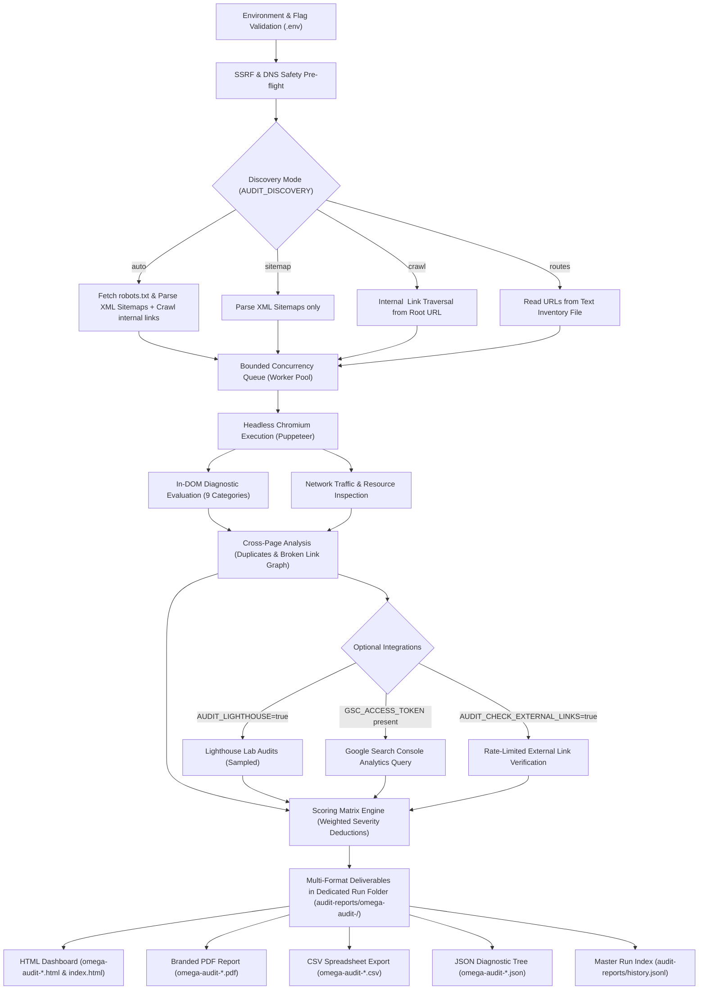

# Omega Site Audit Pro Universal V4 — Complete Technical Manual

**Release Version:** 4.0.0  
**Package Root:** `C:\Users\numan\Downloads\omega-site-audit-pro-universal-v4\omega-site-audit-pro-universal-v4`  
**Runtime Requirement:** Node.js `>=20.0.0` (ESM module architecture)  
**Primary Engine:** Puppeteer (Headless Chromium)  

---

## 1. System Overview & Core Philosophy

Omega Site Audit Pro Universal V4 is a production-grade, read-only website audit and technical compliance engine. It is engineered to crawl modern web properties (SPAs, SSR apps, Jamstack, and traditional multi-page websites) to discover, evaluate, and report across 9 distinct diagnostic categories without executing destructive actions or modifying target systems.

### Key Tenets
1. **100% Read-Only Safety**: The engine never injects payloads, never triggers writes, never submits mutation forms, and never modifies source files.
2. **SSRF & Private Network Defense**: Implements strict RFC 1918 / RFC 4193 / loopback IP address filtering. Local targets (e.g. `http://localhost:3000`) require explicit authorization via `AUDIT_ALLOW_PRIVATE_NETWORK=true`.
3. **Evidence-Based & Deterministic Scoring**: Scores start at 100 and apply transparent mathematical deductions based on verified issues. Heuristic categories outside the active profile are reported as `null` (unavailable) rather than awarding artificial 100s.
4. **Honest Metric Boundary**: Real browser snapshot metrics (LCP, CLS, TTFB) are clearly distinguished from lab audits (Lighthouse) and field telemetry (Google Search Console). INP is never fabricated when interaction telemetry is unavailable.

---

## 2. Directory & Component Architecture

```
omega-site-audit-pro-universal-v4/
├── .env.example                  # Canonical configuration template
├── package.json                  # Node.js ESM package definition (Puppeteer ^24.0.0)
├── README.md                     # Quickstart and overview
├── docs/
│   ├── ARCHITECTURE.md           # Pipeline data flow and security boundaries
│   ├── INTEGRATION-GUIDE.md      # Step-by-step instructions for embedding into web apps
│   ├── OMEGA-AUDIT-V4-MANUAL.md  # Comprehensive technical manual & reference
│   ├── PROMPT-FOR-ANTIGRAVITY.md # Migration instructions for Antigravity agents
│   └── TESTING.md                # Unit and end-to-end verification guide
├── examples/
│   └── audit-routes.example.txt  # Sample inventory file for route-list discovery mode
├── scripts/
│   ├── audit-site.mjs            # Primary audit engine & headless crawler CLI
│   └── manage-history.mjs        # Historical comparison, competitor benchmarking & import/export
├── src/
│   ├── core.mjs                  # Pure helper library: URL normalization, parsing, scoring, diffing
│   ├── gsc.mjs                   # Google Search Console Search Analytics API client
│   └── report.mjs                # HTML, PDF, CSV, and JSON report generator
└── tests/
    ├── core.test.mjs             # Unit tests for URL sanitation, parsing, and scoring algorithms
    └── report.test.mjs           # Unit tests for HTML escaping, CSV encoding, and report structure
```

---

## 3. Crawler Engine & Execution Pipeline



---

## 4. Complete Configuration Reference (`.env`)

| Variable | Type | Default | Permitted Values | Purpose & Technical Behavior |
|---|---|---|---|---|
| `SITE_URL` | String | `http://localhost:4321` | Valid `http://` or `https://` URL | Root origin to audit. Crawl scope is locked to this exact origin. |
| `AUDIT_ALLOW_PRIVATE_NETWORK` | Boolean | `false` | `true`, `false` | **Required `true` for local testing.** Permits navigation to loopback (127.0.0.1) and private subnets (10.x, 192.168.x, 172.16-31.x). |
| `AUDIT_DISCOVERY` | String | `auto` | `auto`, `sitemap`, `crawl`, `routes` | Strategy to discover URLs on the target origin. |
| `AUDIT_ROUTES_FILE` | String | `""` | File path | Path to text file containing line-separated URLs for `routes` discovery mode. |
| `AUDIT_MAX_PAGES` | Integer | `0` | `0` to `100000000` | Maximum pages to audit. `0` disables count ceiling (resource ceilings remain active). |
| `AUDIT_CRAWL_DEPTH` | Integer | `8` | `0` to `100` | Maximum link depth from root URL when following internal hyperlinks. |
| `AUDIT_CONCURRENCY` | Integer | `2` | `1` to `8` | Number of simultaneous Chromium browser tabs/workers. |
| `AUDIT_REQUEST_DELAY_MS` | Integer | `150` | `0` to `10000` | Polite delay between navigations. If `robots.txt` specifies `Crawl-delay`, the higher value is respected. |
| `AUDIT_TIMEOUT_MS` | Integer | `20000` | `1000` to `120000` | Browser navigation timeout per page in milliseconds. |
| `AUDIT_RETRIES` | Integer | `1` | `0` to `4` | Number of retry attempts on navigation timeout or network failure. |
| `AUDIT_SETTLE_MS` | Integer | `350` | `0` to `10000` | Post-load quiescence wait time to allow client-side hydration and DOM rendering. |
| `AUDIT_MAX_DURATION_MINUTES` | Integer | `120` | `1` to `1440` | Global wall-clock execution ceiling. Safely wraps up and writes reports when reached. |
| `AUDIT_MAX_HEAP_MB` | Integer | `1536` | `256` to `8192` | Node.js heap ceiling. Triggers proactive termination before V8 encounters an OOM crash. |
| `AUDIT_RESPECT_ROBOTS` | Boolean | `true` | `true`, `false` | When `true`, URLs disallowed by `robots.txt` for the user-agent are skipped. |
| `AUDIT_KEEP_QUERY` | Boolean | `false` | `true`, `false` | When `false`, marketing parameters (`utm_*`, `fbclid`, `gclid`) and query strings are stripped during deduplication. |
| `AUDIT_INCLUDE_PATHS` | String | `""` | Glob / Regex | Comma-separated path filters (e.g. `/blog/**,/tools/*` or `re:^/convert/`). |
| `AUDIT_EXCLUDE_PATHS` | String | `""` | Glob / Regex | Comma-separated exclusions (e.g. `/logout,/admin/**`). |
| `AUDIT_PROFILE` | String | `professional` | See Profile Table | Preset determining which heuristic modules are evaluated and displayed in reports. |
| `AUDIT_PROFILE_CATEGORIES` | String | `""` | Comma-separated | Categories evaluated when `AUDIT_PROFILE=custom` (e.g. `seo,accessibility,mobile`). |
| `AUDIT_CHECK_EXTERNAL_LINKS` | Boolean | `false` | `true`, `false` | Enables asynchronous HEAD/GET verification of third-party public links found on pages. |
| `AUDIT_MAX_EXTERNAL_LINKS` | Integer | `300` | `1` to `5000` | Maximum distinct external URLs to probe per audit run. |
| `AUDIT_LIGHTHOUSE` | Boolean | `false` | `true`, `false` | Enables Google Lighthouse lab audits (requires `npm i lighthouse`). |
| `AUDIT_LIGHTHOUSE_MAX_PAGES` | Integer | `3` | `1` to `100` | Maximum pages sampled for Lighthouse execution to prevent excessive CPU/RAM usage. |
| `GSC_SITE_URL` | String | `""` | Authorized URL | Google Search Console verified property URL. |
| `GSC_ACCESS_TOKEN` | String | `""` | Bearer Token | Short-lived OAuth access token with read-only searchconsole scope. |
| `GSC_START_DATE` | String | `""` | `YYYY-MM-DD` | Start date for Search Analytics query. |
| `GSC_END_DATE` | String | `""` | `YYYY-MM-DD` | End date for Search Analytics query. |
| `AUDIT_AUTH_HEADERS_FILE` | String | `""` | File Path | Path to private JSON file with HTTP headers (e.g. staging bearer token). Origin-locked. |
| `AUDIT_COMPARE_WITH` | String | `""` | File Path | Path to previous audit JSON report to generate inline delta annotations. |
| `AUDIT_BRAND` | String | `NumanX / Omega Site Audit Pro` | String | White-label brand string printed on HTML and PDF headers. |
| `AUDIT_OUTPUT_DIR` | String | `audit-reports` | Directory Path | Target directory for generated HTML, PDF, CSV, JSON, and `history.jsonl` files. |

---

## 5. Audit Profiles

| Profile ID | Focus Area | Included Diagnostic Categories |
|---|---|---|
| `professional` / `full` | Enterprise Master Audit | SEO, Accessibility, Performance, Security, Mobile, Content, GEO/AEO, Schema, Resources |
| `quick` | Essential Health Check | Core SEO, Accessibility, Technical Links, Failed Images, Mobile Viewport |
| `seo` | Organic Search Optimization | On-page SEO, Schema JSON-LD, Internal Links, Canonicalization, Content, GEO/AEO |
| `performance` | Core Web Vitals & Loading | Browser LCP/CLS snapshots, Resource Transfer, Fonts, DOM Node Count, Ad CLS risks |
| `accessibility` | Inclusive UX & WCAG | Alt attributes, form labels, ARIA attributes, semantic landmarks, color contrast cues |
| `security` | Passive Hardening | Security headers (CSP, HSTS, X-Content-Type-Options), mixed content, target safety |
| `geo-aeo` | AI Engine Visibility | FAQ schemas, definition callouts, structured matrices, table captions/headers, answer capsules |
| `ads-fonts` | Monetization & Web Typography | Ad slot size reservation, font-display swap, excessive web font count, shift hazards |
| `custom` | User-Defined Matrix | Configured dynamically via `AUDIT_PROFILE_CATEGORIES` |

---

## 6. Diagnostic Heuristics & Audit Categories

### 1. SEO & Metadata
- **Title Tag**: Validates presence, non-emptiness, length within 30–65 characters, and flags cross-page duplicate titles.
- **Meta Description**: Validates presence, length within 70–160 characters, and cross-page duplicates.
- **Canonical URL**: Ensures `<link rel="canonical">` exists, is absolute, matches page URL (or intentional canonical), and doesn't point to an invalid origin.
- **Heading Structure**: Checks for exactly one `<h1>`, flags missing `<h1>`, warns on multiple `<h1>` tags, and detects hierarchy skips (e.g. `<h1>` immediately followed by `<h3>`).
- **Robots Directives**: Checks `<meta name="robots">` for unintended `noindex`, `nofollow`, or `none`.
- **Social Graph**: Validates OpenGraph (`og:title`, `og:description`, `og:image`, `og:url`) and Twitter Cards.
- **Language & Favicon**: Flags missing `<html lang>` and missing favicon.

### 2. Accessibility (a11y)
- **Image Alternatives**: Flags `` missing `alt` attributes or with placeholder text.
- **Form Accessibility**: Flags `<input>`, `<select>`, `<textarea>` missing associated `<label>`, `id`, or `aria-label`.
- **Link Quality**: Flags empty links (`<a></a>`), links with generic anchor text ("click here", "read more"), or missing accessible text.
- **Landmark Architecture**: Verifies semantic landmarks (`<main>`, `<nav>`, `<header>`, `<footer>`).
- **Focus & Keyboard Navigation**: Flags anti-patterns such as `tabindex > 0`.

### 3. Structured Data (Schema.org / JSON-LD)
- **Syntax Validation**: Parses every `<script type="application/ld+json">`, catching trailing commas or invalid JSON syntax.
- **Entity Discovery**: Extracts and catalogs all `@type` entities (`WebApplication`, `FAQPage`, `Dataset`, `BreadcrumbList`, `HowTo`, `Article`).
- **Graph Deduplication**: Flags redundant or colliding schemas on the same URL.

### 4. Passive Security & Response Headers
- **Security Headers**: Inspects HTTP responses for `Content-Security-Policy`, `Strict-Transport-Security`, `X-Content-Type-Options: nosniff`, `X-Frame-Options`, `Referrer-Policy`, and `Permissions-Policy`.
- **Mixed Content**: Detects insecure `http://` resources requested inside an `https://` origin.
- **Reverse Tabnabbing**: Checks external `<a>` tags with `target="_blank"` to guarantee `rel="noopener noreferrer"`.

### 5. Mobile & Viewport Optimization
- **Viewport Meta**: Validates `<meta name="viewport" content="width=device-width, initial-scale=1">`.
- **Horizontal Overflow**: Dynamically evaluates `document.documentElement.scrollWidth > window.innerWidth` to catch elements that cause horizontal scrolling.
- **Tap Targets**: Identifies touch targets smaller than 24x24px that may cause mis-taps on mobile devices.

### 6. Performance & Resource Loading
- **Browser Snapshots**: Captures client-side Largest Contentful Paint (LCP) and Cumulative Layout Shift (CLS) via `PerformanceObserver`.
- **DOM Complexity**: Measures total DOM element count (flags DOMs exceeding 1,500 nodes).
- **Resource Footprint**: Measures total transfer bytes, script requests, stylesheet requests, and image weights.
- **Web Fonts**: Identifies `@font-face` definitions missing `font-display: swap` or excessive font families (>4).

### 7. Content Quality & Cross-Page Deduplication
- **Thin Content**: Flags informational pages with fewer than 200 words of substantive text.
- **Content Hashing**: Computes normalized text hashes (stripping whitespace, punctuation, and navigation boilerplate) to detect duplicate or near-duplicate URLs across the domain.
- **Ad Slot Layout**: Identifies unreserved ad containers that risk triggering layout shifts.

### 8. Link & Resource Health
- **Internal Broken Links**: Discovers and maps internal 404, 500, or broken anchor fragments.
- **Resource Failures**: Monitors network response status codes for broken scripts, stylesheets, and fonts.
- **External Links (Optional)**: Bounded validation of outbound hyperlinks.

### 9. GEO / AEO (Generative & Answer Engine Optimization)
- **Answer Capsules**: Identifies concise, factual 40–60 word introductory definitions directly under `<h1>`.
- **Structured Data Density**: Verifies machine-readable entities (`Dataset`, `FAQPage`, `HowTo`).
- **Table Semantics**: Verifies tabular data contains `<caption>` and `<th scope="col">` to support extraction into Google Table Snippets and AI summaries.

---

## 7. Scoring Algorithm & Mathematical Formulations

Every page is evaluated independently across active categories and assigned scores between 0 and 100:

$$\text{Category Score} = \max\left(0, 100 - \sum \text{Deductions}\right)$$

### Severity Deduction Table

| Finding Severity | Deduction Points | Definition & Impact |
|---|---|---|
| **Critical** | **-20 pts** | Direct indexing killer, severe crash, empty title, invalid canonical, HTTP 500/404 on target. |
| **High** | **-10 pts** | Missing meta description, missing H1, broken internal link, malformed JSON-LD, missing viewport. |
| **Medium** | **-5 pts** | Heading hierarchy skip (H1 → H3), image missing alt, unreserved ad container, slow LCP. |
| **Low** | **-2 pts** | Sub-optimal title length, minor contrast suggestion, unoptimized font-display. |
| **Info** | **0 pts** | Informational telemetry, verified schema types, detected frameworks. |

$$\text{Overall Page Score} = \frac{\sum_{i=1}^{N} \text{Active Score}_i}{N}$$

*Note:* If a category is omitted by the active profile (e.g. `security` during a `quick` audit), its score is recorded as `null` and excluded from the overall average calculation, preventing inflated 100% scores.

---

## 8. Interactive CLI Controls

During an active crawl, the terminal provides real-time keystroke interception:

| Key Command | Action | Behavior |
|---|---|---|
| `p` + `Enter` | **Pause** | Halts queueing of new page navigations. In-flight browser tabs complete cleanly. |
| `r` + `Enter` | **Resume** | Resumes processing URLs from the queued worker pool. |
| `c` + `Enter` | **Cancel & Save** | Immediately halts the crawler, compiles findings collected so far, and writes full reports. |
| `Ctrl + C` | **Graceful Abort** | Requests safe browser shutdown and persists partial findings to disk. |

---

## 9. History & Comparison CLI (`scripts/manage-history.mjs`)

The package includes a standalone comparison and bundle manager that operates directly on generated report JSON files.

### 1. Regression Comparison (Scan vs. Scan)
Compares a baseline audit against a newer audit on the same domain to highlight resolved, recurring, and newly introduced issues:
```powershell
node scripts/manage-history.mjs compare .\audit-reports\baseline.json .\audit-reports\current.json .\audit-reports\diff.json
```
**Output Highlights:**
- `newIssues`: Findings present in current that were not in baseline.
- `resolvedIssues`: Issues successfully fixed since the baseline scan.
- `recurringIssues`: Persisting issues across both scans.

### 2. Competitor / Two-Site Comparison
Compares two distinct websites across public technical metrics:
```powershell
node scripts/manage-history.mjs compare-sites .\audit-reports\my-site.json .\audit-reports\competitor.json .\audit-reports\comparison.json
```
**Output Highlights:**
- Average heuristic scores per category (`seo`, `accessibility`, `performance`, `security`, `mobile`).
- Score delta matrix ($\text{Site B} - \text{Site A}$).
- Severity and category breakdown comparison.
- Strict comparability disclaimer (acknowledging different hosting environments).

### 3. Report Bundling & Export
Packs all individual JSON audit reports in a folder into a single portable bundle:
```powershell
node scripts/manage-history.mjs export .\audit-reports .\audit-reports\omega-history-bundle.json
```

### 4. Bundle Import
Unpacks a report bundle into a target directory and safely rebuilds the local `history.jsonl` index:
```powershell
node scripts/manage-history.mjs import .\audit-reports\omega-history-bundle.json .\audit-reports\imported
```

---

## 10. Execution Workflows & Practical Commands

### Scenario A: Local Development Site Smoke Test (e.g. Vite on port 3000)
```powershell
$env:SITE_URL="http://localhost:3000"
$env:AUDIT_ALLOW_PRIVATE_NETWORK="true"
$env:AUDIT_MAX_PAGES="15"
$env:AUDIT_CONCURRENCY="2"
$env:AUDIT_PROFILE="quick"
npm run audit
```

### Scenario B: Full Production Audit (Unlimited Count with Duration Safeguard)
```powershell
$env:SITE_URL="https://numanx-omega.netlify.app"
$env:AUDIT_ALLOW_PRIVATE_NETWORK="false"
$env:AUDIT_MAX_PAGES="0"
$env:AUDIT_MAX_DURATION_MINUTES="60"
$env:AUDIT_CONCURRENCY="3"
$env:AUDIT_PROFILE="professional"
npm run audit
```

### Scenario C: Curated Route-List Audit
```powershell
$env:SITE_URL="https://numanx-omega.netlify.app"
$env:AUDIT_DISCOVERY="routes"
$env:AUDIT_ROUTES_FILE="./examples/audit-routes.example.txt"
$env:AUDIT_PROFILE="seo"
npm run audit
```

### Scenario D: Automated Test Suite Verification
```powershell
# Syntax validation of all CLI scripts and source modules
node --check scripts/audit-site.mjs
node --check scripts/manage-history.mjs
node --check src/core.mjs
node --check src/report.mjs
node --check src/gsc.mjs

# Execute unit and integration tests
node --test
```
